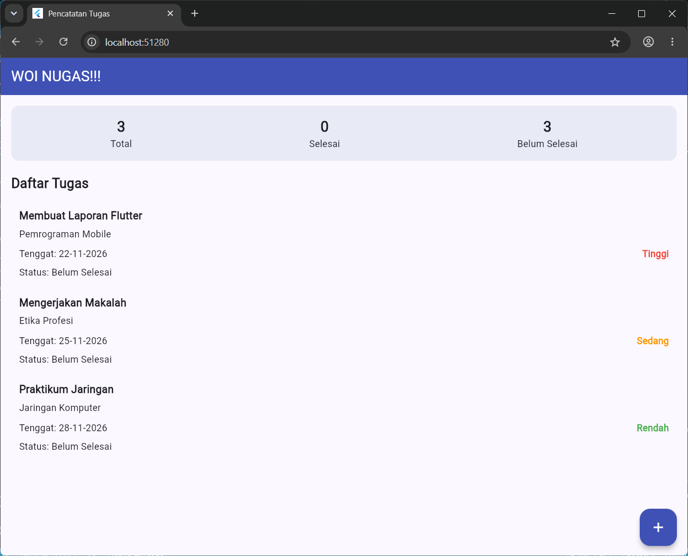
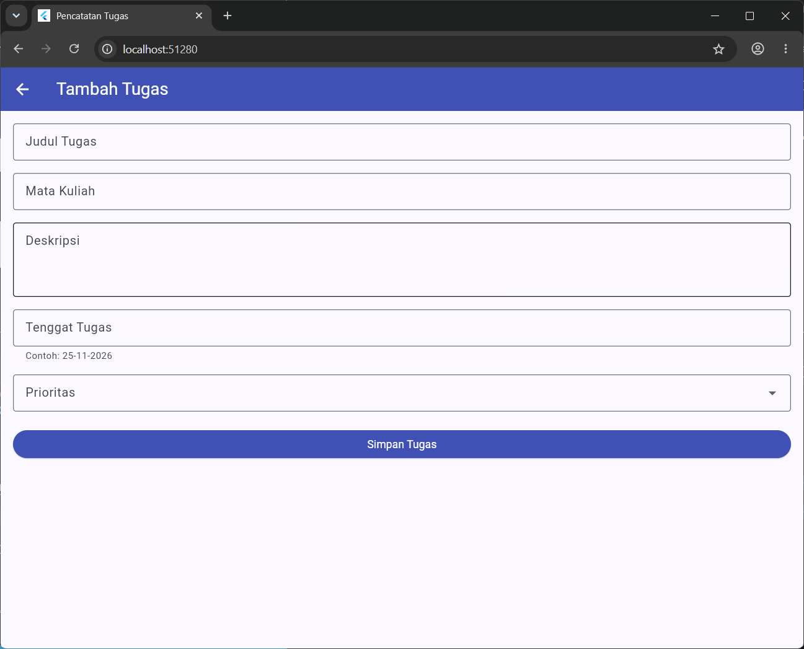
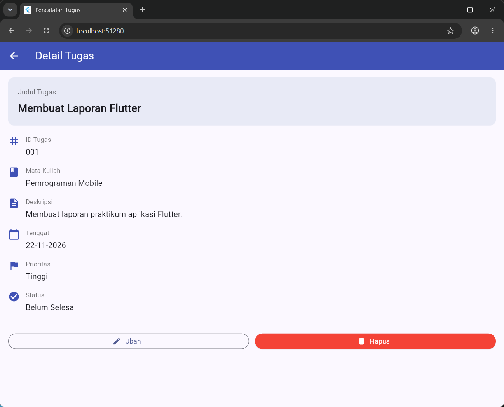
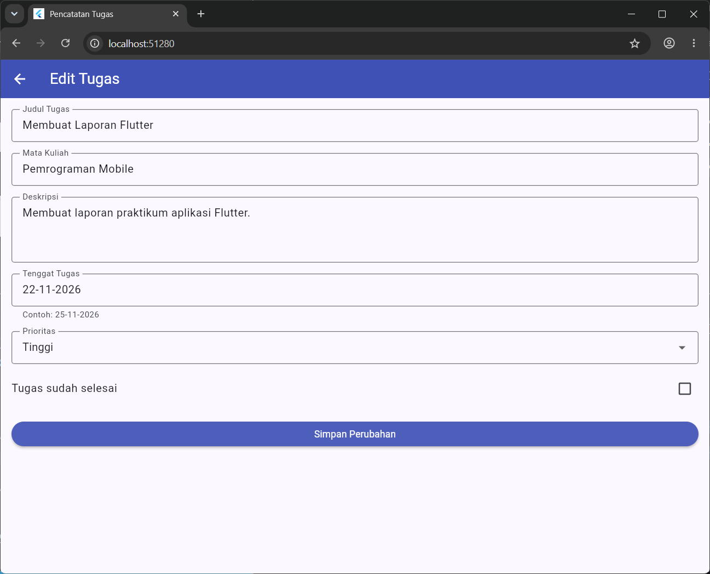
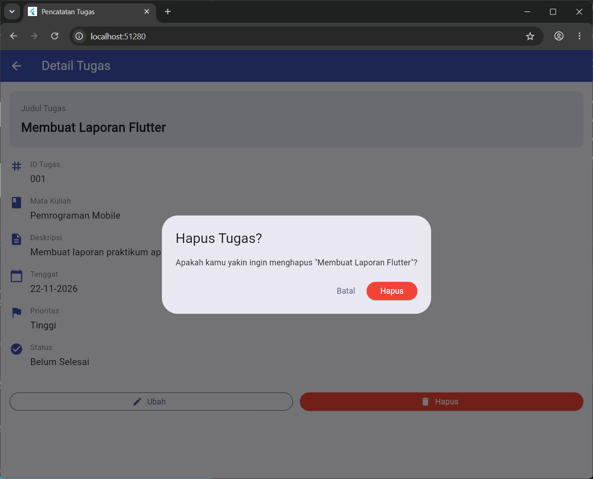
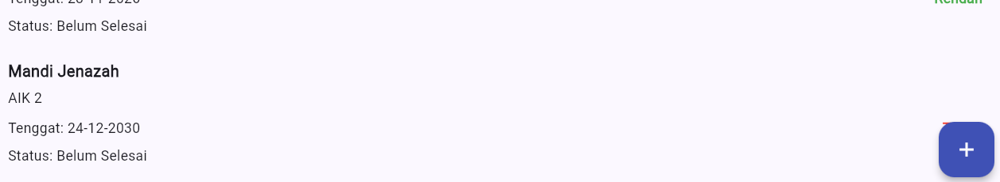
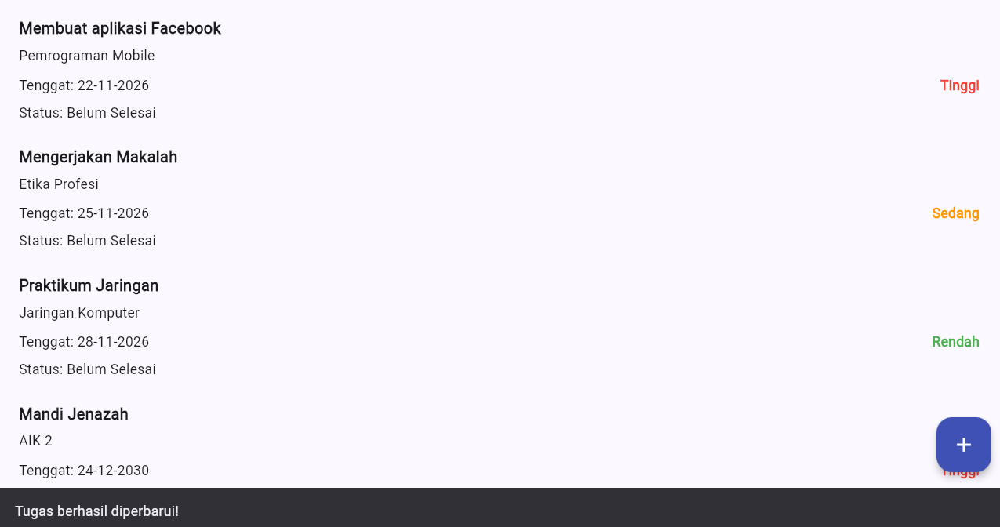
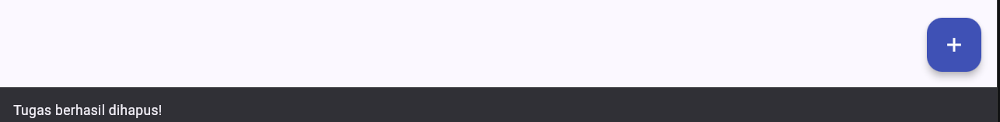
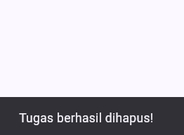

# TugasKu - Aplikasi Pencatat Tugas dan Tenggat Kuliah

Aplikasi mobile Android berbasis Flutter untuk membantu mahasiswa mencatat dan mengelola tugas kuliah. TugasKu menyediakan fitur melihat daftar dan detail tugas, menambahkan tugas, mengubah informasi/status tugas, serta menghapus tugas dengan konfirmasi.

## Identitas Pengembang

| Keterangan | Informasi |
|---|---|
| Nama | Raihan Doan |
| NIM | C2483207005 |
| Kelas | PTI 5A |
| Program Studi | Pendidikan Teknologi Informasi |
| Mata Kuliah | Pemrograman Mobile |

## Deskripsi Aplikasi

Informasi tugas kuliah dapat tersebar dari berbagai mata kuliah dan sumber penyampaian. TugasKu dibuat sebagai prototipe pencatat tugas agar informasi judul, mata kuliah, deskripsi, tenggat, prioritas, dan status penyelesaian dapat dikelola dalam satu aplikasi.

Data pada prototipe disimpan sementara di dalam `List<Tugas>` pada memori aplikasi. Data yang ditambahkan atau diubah tidak dipertahankan setelah aplikasi ditutup dan dijalankan ulang. Aplikasi tidak menggunakan database, REST API, Firebase, maupun layanan penyimpanan eksternal.

## Teknologi yang Digunakan

- **Flutter** - framework untuk membangun antarmuka aplikasi Android.
- **Dart** - bahasa pemrograman aplikasi.
- **Material Design / Material Widgets** - komponen antarmuka seperti `MaterialApp`, `Scaffold`, `AppBar`, `Card`, `Form`, dan tombol.
- **Penyimpanan sementara** - `List<Tugas>` di dalam memori.
- **Tools pengembangan** - Flutter SDK, Dart SDK, Visual Studio Code atau Android Studio, serta Android Emulator atau perangkat Android.

> Catat versi Flutter yang benar-benar digunakan dengan menjalankan `flutter --version`, lalu tuliskan hasilnya pada bagian ini sebelum repository dikumpulkan.

## Daftar Fitur

1. Menampilkan daftar tugas menggunakan `ListView.builder`.
2. Menyediakan tiga data tugas contoh saat aplikasi pertama kali dibuka.
3. Menampilkan ringkasan jumlah tugas, tugas selesai, dan tugas belum selesai.
4. Menampilkan detail tugas: ID, judul, mata kuliah, deskripsi, tenggat, prioritas, dan status.
5. Menambahkan tugas melalui form.
6. Memvalidasi judul (wajib, minimal 3 karakter), mata kuliah (wajib), deskripsi (wajib, minimal 10 karakter), tenggat (format `DD-MM-YYYY` dan tanggal nyata), serta prioritas (Rendah/Sedang/Tinggi).
7. Mengubah tugas dengan form yang terisi otomatis menggunakan `TextEditingController`.
8. Mengubah status selesai ketika mengedit tugas.
9. Menghapus tugas setelah pengguna mengonfirmasi melalui `AlertDialog`.
10. Memperbarui daftar dan ringkasan menggunakan `setState()` serta menampilkan `SnackBar` setelah operasi berhasil.

## Struktur Folder

```text
lib/
├── main.dart
├── models/
│   └── tugas.dart
└── screens/
    ├── daftar_tugas_page.dart
    ├── form_tugas_page.dart
    └── detail_tugas_page.dart

screenshots/
├── 01_Halaman_Utama.png
├── 02_Halaman_Daftar.png
├── 03_Form_Tambah.png
├── 04_Halaman_Detail.png
├── 05_Form_Edit.png
├── 06_Konfirmasi_Hapus.png
├── 07_Hasil_Tambah.png
├── 08_Hasil_Update.png
├── 09_Hasil_Delete.png
└── 10_Validasi_Form.png
```

Folder `screenshots/` perlu dibuat dan diisi dengan screenshot asli dari aplikasi yang berjalan di emulator atau perangkat Android. Nama berkas di atas mengikuti ketentuan dokumentasi UTS.

## Instalasi dan Menjalankan Aplikasi

### Persyaratan

- Flutter SDK telah dipasang dan masuk ke `PATH`.
- Android Studio/Android SDK atau perangkat Android dengan USB debugging aktif.
- VS Code atau editor kode lain (opsional, tetapi disarankan).

Periksa instalasi Flutter:

```bash
flutter --version
flutter doctor
```

### Langkah menjalankan

1. Clone repository atau unduh source code proyek.

   ```bash
   git clone <URL_REPOSITORY_GITHUB>
   ```

2. Masuk ke direktori proyek.

   ```bash
   cd tugas_ku
   ```

3. Ambil dependensi proyek.

   ```bash
   flutter pub get
   ```

4. Pastikan emulator Android aktif atau perangkat Android sudah terhubung. Periksa perangkat yang terdeteksi.

   ```bash
   flutter devices
   ```

5. Jalankan aplikasi.

   ```bash
   flutter run
   ```

Tidak diperlukan package pihak ketiga. Proyek mengikuti batasan soal UTS untuk menggunakan Flutter SDK tanpa dependensi tambahan di `pubspec.yaml`.

## Screenshot Aplikasi

Tambahkan screenshot asli ke folder `screenshots/` dengan nama berkas berikut. Setelah berkas tersedia, gambar akan tampil di bagian ini pada tampilan GitHub.

### 1. Halaman Utama



### 2. Form Tambah



### 3. Halaman Detail



### 4. Form Edit



### 5. Konfirmasi Hapus



### 6. Hasil Tambah



### 7. Hasil Update



### 8. Hasil Delete



### 9. Validasi Form



## Video Demonstrasi YouTube

**URL video:** `ISI_DENGAN_URL_VIDEO_YOUTUBE`

Ganti teks di atas dengan URL video demonstrasi YouTube yang sudah diunggah. Pastikan visibilitas video adalah **Unlisted** atau **Public**, bukan Private, agar dapat diakses dosen.

## Repository GitHub

**URL repository:** `ISI_DENGAN_URL_REPOSITORY_GITHUB`

Gunakan nama repository sesuai format tugas:

```text
UTS-Pemrograman-Mobile-C2483207005-Raihan-Doan
```

## Catatan Pengembangan

- Data bersifat sementara dan akan kembali ke data awal ketika aplikasi dijalankan ulang.
- Pastikan tampilan pesan ketika daftar kosong telah diterapkan dan diuji sebelum pengumpulan, karena kondisi daftar kosong termasuk persyaratan halaman utama pada soal.
- Jalankan `dart format lib` dan `flutter analyze` sebelum finalisasi.
- Isi versi Flutter, screenshot, URL YouTube, dan URL GitHub dengan data yang benar-benar tersedia; jangan biarkan placeholder saat pengumpulan.
